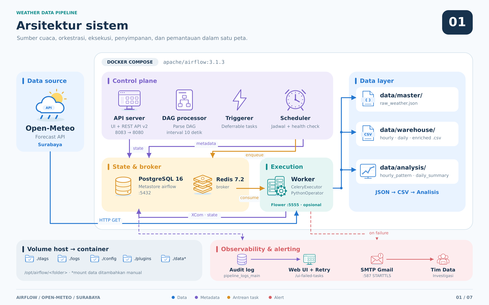
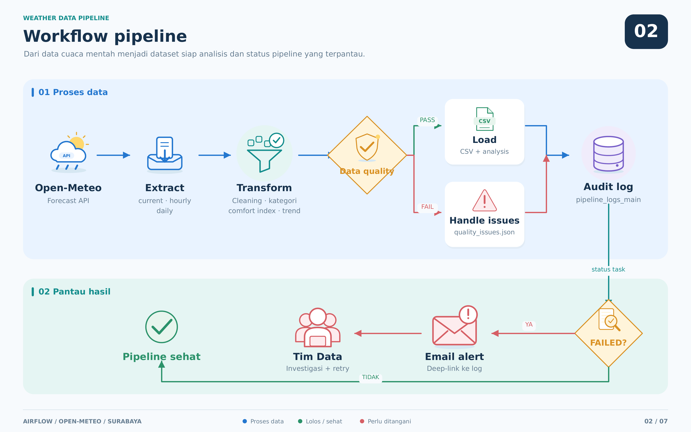
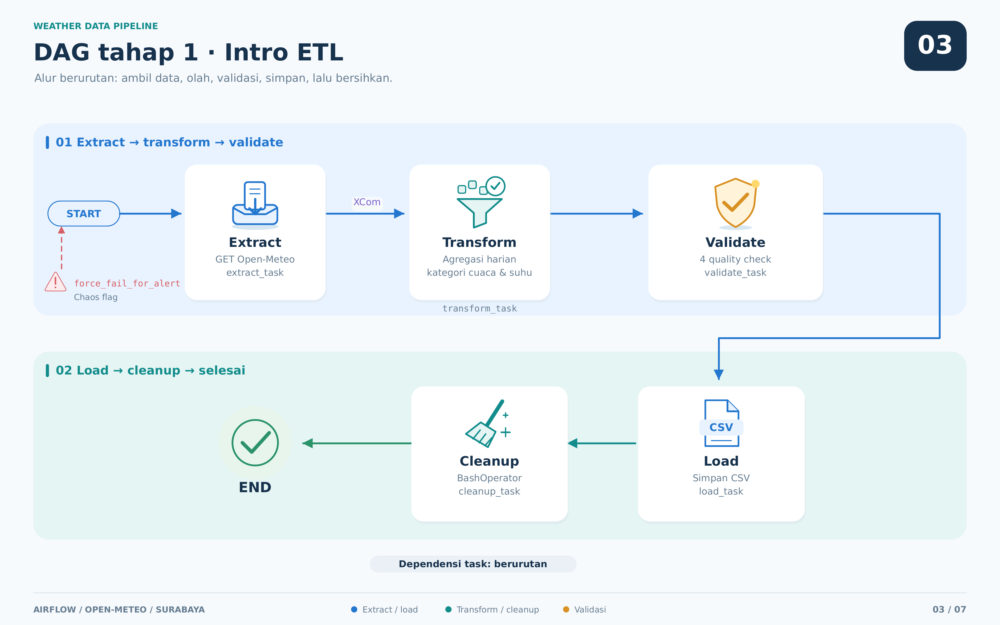
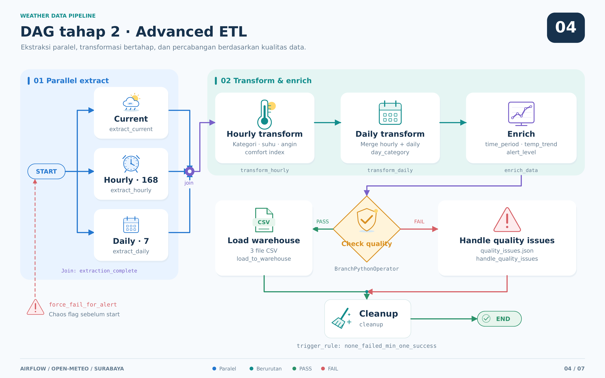
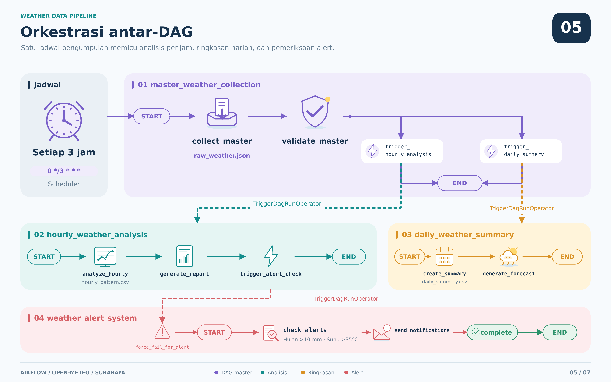
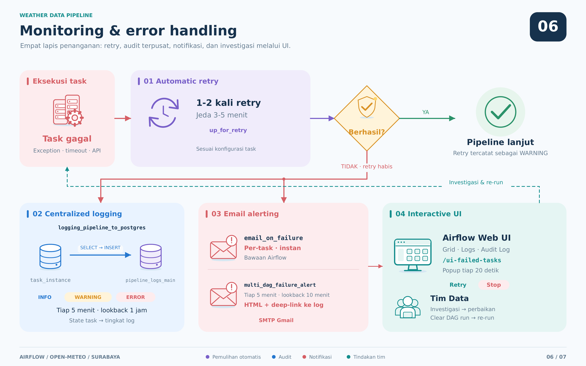
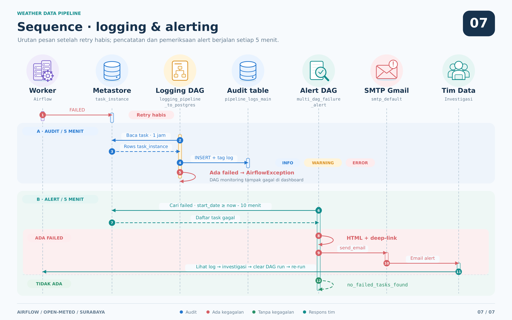

<h1 align="center">🌦️ Airflow Weather Data Pipeline</h1>

<p align="center">
  <b>End-to-End ETL Orchestration dengan Monitoring & Error Handling Terpusat</b><br/>
  <sub>Apache Airflow 3 · CeleryExecutor · PostgreSQL · Docker · Open-Meteo API</sub>
</p>

<p align="center">
  
  
  
  
  
  
</p>

---

Proyek ini membangun **data pipeline cuaca kota Surabaya** di atas Apache Airflow, mulai dari DAG ETL sederhana hingga **sistem observability yang lengkap** dengan logging yang terpusat ke PostgreSQL, alerting otomatis via email, dan UI kustom untuk menangani task yang gagal.

Fokus utamanya bukan sekadar "membuat pipeline yang jalan", melainkan menjawab pertanyaan yang jauh lebih penting di dunia *data engineering*:

> **Bagaimana kita tahu pipeline sedang gagal — dan bagaimana sistem memberi tahu kita sebelum pengguna data yang menemukannya lebih dulu?**

Untuk menjawabnya, proyek ini mengimplementasikan **4 lapis pertahanan** (retry → centralized logging → email alerting → interactive UI) yang bekerja berlapis di atas 9 DAG dengan berbagai pola orkestrasi.

**Sumber data:** [Open-Meteo Forecast API](https://open-meteo.com/) — Surabaya `(lat −7.25, lon 112.75)`, timezone `Asia/Jakarta`, tanpa API key.

---

## Highlight Teknis

<table>
<tr>
<td width="50%" valign="top">

**🔀 Orkestrasi Multi-DAG**
<br/>Fan-out pattern: satu *master DAG* memicu dua DAG analitik secara paralel, salah satunya memicu DAG alert berikutnya — rantai 4 DAG tanpa intervensi manual.

**🌿 Conditional Branching**
<br/>`BranchPythonOperator` memilih jalur `load_to_warehouse` atau `handle_quality_issues` berdasarkan hasil validasi kualitas data secara runtime.

**📝 Centralized Audit Trail**
<br/>DAG monitoring membaca tabel `task_instance` dari metastore Airflow setiap 5 menit dan menuliskannya ke tabel `pipeline_logs_main` dengan klasifikasi `INFO` / `WARNING` / `ERROR`.

</td>
<td width="50%" valign="top">

**📧 Alerting Dua Jalur**
<br/>Kombinasi `email_on_failure` bawaan Airflow (per-task) + DAG alert kustom yang mengirim **ringkasan HTML berisi deep-link langsung ke halaman log** task yang gagal.

**🖥️ Custom Airflow Plugin**
<br/>Flask Blueprint `/ui-failed-tasks` yang melakukan polling tiap 20 detik dan memunculkan popup peringatan dengan tombol **Retry** (clear DAG run via REST API) dan **Stop**.

**🧪 Chaos-Testing Flag**
<br/>Task `force_fail_for_alert` yang membaca `dag_run.conf` — memungkinkan kegagalan dipicu **on-demand** untuk memverifikasi bahwa rantai alerting benar-benar bekerja.

</td>
</tr>
</table>

---

## Arsitektur Sistem

Arsitektur teknologi dipisahkan menjadi lima bidang: *data source*, *control plane*, *execution plane*, *state & storage*, dan *observability*.



### Keputusan Arsitektur

| Keputusan | Alasan |
|---|---|
| **CeleryExecutor** | Memisahkan *scheduling* dari *execution*, memungkinkan horizontal scaling worker dan mensimulasikan topologi produksi. |
| **PostgreSQL sebagai metastore *dan* log store** | Tabel `task_instance` milik Airflow bisa di*query* langsung sebagai sumber kebenaran monitoring tanpa perlu stack observability eksternal. |
| **Polling-based monitoring** (cron `*/5`) | Lebih sederhana dan lebih handal dibanding callback `on_failure_callback` yang ikut gagal apabila proses worker-nya sendiri *crash*. |

---

## Tech Stack

| Kategori | Teknologi | Versi / Detail |
|---|---|---|
| **Orchestration** | Apache Airflow | `3.1.3` · CeleryExecutor · FabAuthManager |
| **Bahasa** | Python | `3.12` |
| **Database** | PostgreSQL | `16` — metastore + audit log |
| **Message Broker** | Redis | `7.2-bookworm` |
| **Containerization** | Docker Compose | 10 service terkoordinasi |
| **Data Processing** | pandas, requests, json | transformasi & agregasi |
| **Notifikasi** | SMTP Gmail | `send_email_smtp` · port 587 STARTTLS |
| **Custom UI** | Flask Blueprint | `AirflowPlugin` + REST API |
| **Monitoring Tools** | Flower, pgAdmin 4 | celery monitoring, inspeksi DB |
| **Data Source** | Open-Meteo API | gratis, tanpa autentikasi |


---

## Katalog DAG

Total **9 DAG** terdistribusi dalam **5 file Python**.

| # | `dag_id` | Schedule | Trigger | Peran |
|:--:|---|---|:--:|---|
| 1 | `intro_etl_workflow` | `@daily` | cron | ETL dasar: extract → transform → validate → load |
| 2 | `advanced_weather_etl` | `0 */6 * * *` | cron | ETL lanjutan: parallel extract, enrichment, branching |
| 3 | `master_weather_collection` | `0 */3 * * *` | cron | **Entrypoint orkestrasi** — memicu DAG 4 & 5 |
| 4 | `hourly_weather_analysis` | `None` | triggered | Analisis pola per jam → memicu DAG 6 |
| 5 | `daily_weather_summary` | `None` | triggered | Ringkasan & forecast harian |
| 6 | `weather_alert_system` | `None` | triggered | Deteksi anomali cuaca (hujan lebat / suhu ekstrem) |
| 7 | `logging_pipeline_to_postgres` | `*/5 * * * *` | cron | **Audit trail** → tabel `pipeline_logs_main` |
| 8 | `multi_dag_failure_alert` | `*/5 * * * *` | cron | **Email alert** ringkasan task `failed` |
| 9 | `email_on_failure_demo` | `None` | manual | Demo mekanisme `email_on_failure` bawaan |

### Konfigurasi Resiliensi per DAG

| `dag_id` | `retries` | `retry_delay` | `email_on_failure` | `catchup` |
|---|:--:|:--:|:--:|:--:|
| `intro_etl_workflow` | 1 | 5 menit | `False` | `False` |
| `advanced_weather_etl` | **2** | 3 menit | **`True`** | `False` |
| `master_weather_collection` | 1 | 5 menit ᵈ | – | `False` |
| `hourly_weather_analysis` | 1 | 5 menit ᵈ | – | `False` |
| `daily_weather_summary` | 1 | 5 menit ᵈ | – | `False` |
| `weather_alert_system` | 1 | 5 menit ᵈ | – | `False` |
| `logging_pipeline_to_postgres` | 0 ᵈ | – | – | `False` |
| `multi_dag_failure_alert` | **0** | – | – | `False` |
| `email_on_failure_demo` | **0** | – | **`True`** | `False` |


---

## Workflow System



---

### Tahap 1 — `intro_etl_workflow`

ETL linier dengan *quality gate* yang diletakkan **sebelum** proses load, sehingga data cacat tidak pernah sampai ke storage.



**Quality check yang dijalankan:** `no_nulls` · `valid_temperature_range (−50…60 °C)` · `valid_rain_values (≥ 0)` · `sufficient_data`. Jika ada yang gagal → `raise ValueError` → task `failed` → terdeteksi oleh sistem monitoring Tahap 4.

**Transformasi:** agregasi harian (`mean`/`min`/`max` suhu, `sum` curah hujan) dan kategorisasi — *Hujan Lebat / Hujan Ringan / Cerah*, serta *Panas / Hangat / Sejuk*.

---

### Tahap 2 — `advanced_weather_etl`

Tiga *extract* berjalan **paralel**, lalu hasilnya di-*enrich* dan melewati **percabangan kondisional**.



**Enrichment yang ditambahkan:** klasifikasi `time_period` (Pagi/Siang/Sore/Malam), `temp_trend` (Naik/Turun/Stabil), dan `alert_level` (Hijau/Kuning/Merah) berdasarkan ambang curah hujan, suhu, dan kecepatan angin.

---

### Tahap 3 — Orkestrasi Antar-DAG

Satu *master DAG* terjadwal memicu rantai tiga DAG lain lewat `TriggerDagRunOperator` dengan `wait_for_completion=False` (*fire-and-forget*).



**Pola yang dipakai:** `master` menulis satu *shared raw file* (`data/master/raw_weather.json`) yang dibaca oleh DAG hilir, sementara metadata ringkas dilewatkan via **XCom**. Pemisahan ini mencegah payload besar masuk ke metastore.

---

## Monitoring & Error Handling

Inti dari proyek ini. Sistem dirancang berlapis — kegagalan yang lolos dari satu lapis akan ditangkap lapis berikutnya.



### Sequence Diagram — Dari Kegagalan ke Notifikasi




### Ringkasan Mekanisme

| Lapis | Komponen | Pemicu | Latensi | Keluaran |
|:--:|---|---|:--:|---|
| **1** | `retries` + `retry_delay` | otomatis saat exception | 3–5 menit | task dicoba ulang |
| **2** | `logging_pipeline_to_postgres`<br/><sub>task `collect_and_store_task_logs`</sub> | cron `*/5` | ≤ 5 menit | baris di `pipeline_logs_main` |
| **3a** | `email_on_failure` | callback per-task | instan | email per task gagal |
| **3b** | `multi_dag_failure_alert`<br/><sub>task `check_failed_tasks_and_send_email`</sub> | cron `*/5` | ≤ 5 menit | email ringkasan + deep-link |
| **4a** | Airflow Web UI | manual | real-time | Grid view, log, audit log |
| **4b** | Plugin `/ui-failed-tasks` | polling 20 detik | ≤ 20 detik | popup + tombol Retry |

### DAG yang Dipantau

`logging_pipeline_to_postgres` memantau 7 DAG: `intro_etl_workflow`, `advanced_weather_etl`, `master_weather_collection`, `hourly_weather_analysis`, `daily_weather_summary`, `weather_alert_system`, `email_on_failure_demo`.

`multi_dag_failure_alert` memantau 6 DAG — termasuk **DAG monitoring itu sendiri** (`logging_pipeline_to_postgres`), sehingga kegagalan pada sistem monitoring pun tetap menghasilkan notifikasi.

---

## Skema Tabel Audit Log

| Kolom | Tipe | Keterangan |
|---|---|---|
| `id` | `SERIAL` | Primary key auto-increment |
| `log_time` | `TIMESTAMPTZ` | Waktu mulai task (fallback: waktu eksekusi monitoring) |
| `tag` | `TEXT` | Hasil mapping: `failed` → **ERROR**, `up_for_retry`/`up_for_reschedule` → **WARNING**, lainnya → **INFO** |
| `dag` | `TEXT` | Nama DAG yang dipantau |
| `task` | `TEXT` | Nama task |
| `run_id` | `TEXT` | Identitas DAG run (scheduled / manual) |
| `state` | `TEXT` | State mentah dari Airflow |
| `description` | `TEXT` | Metadata gabungan: percobaan ke-n, waktu mulai/selesai, durasi |

---

## Instalasi & Menjalankan

### Prasyarat

| Kebutuhan | Minimum |
|---|---|
| Docker Engine | 20.10+ |
| Docker Compose | v2 |
| RAM | 4 GB (disarankan 8 GB) |
| Disk kosong | 10 GB |
| OS | Linux · macOS · Windows + WSL2 |

### 1 · Clone & Siapkan Direktori

```bash
git clone https://github.com/<username>/airflow-project.git
cd airflow-project

mkdir -p ./dags ./logs ./plugins ./config ./data
```

### 2 · Buat File `.env`

> File ini **tidak boleh** di-commit — sudah terdaftar di `.gitignore`.

```bash
cat > .env <<'EOF'
# UID host agar file yang dibuat container tidak jadi milik root
AIRFLOW_UID=50000

# Kredensial SMTP (Gmail App Password, bukan password akun)
AIRFLOW__SMTP__SMTP_USER=email-anda@gmail.com
AIRFLOW__SMTP__SMTP_PASSWORD=xxxx-xxxx-xxxx-xxxx
AIRFLOW__SMTP__SMTP_MAIL_FROM=email-anda@gmail.com
EOF

# Linux/macOS — sesuaikan UID dengan user aktif
echo "AIRFLOW_UID=$(id -u)" >> .env
```

### 3 · Tambahkan Mount Direktori `data/`

> Secara bawaan `docker-compose.yaml` hanya me-*mount* `dags`, `logs`, `config`, dan `plugins`. Semua DAG menulis hasil ETL ke `/opt/airflow/data/…`, sehingga tanpa mount ini **seluruh output akan hilang saat container dihapus**.

Pada blok `x-airflow-common.volumes`, tambahkan satu baris:

```yaml
  volumes:
    - ${AIRFLOW_PROJ_DIR:-.}/dags:/opt/airflow/dags
    - ${AIRFLOW_PROJ_DIR:-.}/logs:/opt/airflow/logs
    - ${AIRFLOW_PROJ_DIR:-.}/config:/opt/airflow/config
    - ${AIRFLOW_PROJ_DIR:-.}/plugins:/opt/airflow/plugins
    - ${AIRFLOW_PROJ_DIR:-.}/data:/opt/airflow/data     # ← tambahkan baris ini
```

### 4 · Inisialisasi & Jalankan

```bash
# Migrasi database + pembuatan user admin
docker compose up airflow-init

# Jalankan seluruh service
docker compose up -d

# Pantau status sampai semua healthy
docker compose ps
```

### 5 · Akses Layanan

| Layanan | URL | Kredensial |
|---|---|---|
| **Airflow Web UI** | http://localhost:8083 | `airflow` / `airflow` |
| **Plugin Failed Tasks** | http://localhost:8083/ui-failed-tasks | — |
| **PostgreSQL** | `localhost:5432` | `airflow` / `airflow` · db `airflow` |
| **Flower** *(opsional)* | http://localhost:5555 | — |

```bash
# Flower berada di profile terpisah
docker compose --profile flower up -d
```

### 6 · Menghentikan

```bash
docker compose down            # stop, data PostgreSQL tetap ada
docker compose down -v         # stop + hapus volume (reset total)
```

---

## Output yang Dihasilkan

### Artefak Data

| Layer | Lokasi | Isi |
|---|---|---|
| **Raw** | `data/master/raw_weather.json` | Respons mentah Open-Meteo (hourly + daily) |
| **Raw** | `data/raw_weather_data.json` | Respons mentah Tahap 1 & 2 |
| **Warehouse** | `data/warehouse/hourly_weather.csv` | 168 record terkategorisasi |
| **Warehouse** | `data/warehouse/daily_weather.csv` | 7 hari ringkasan + `day_category` |
| **Warehouse** | `data/warehouse/enriched_weather.csv` | Hourly + `time_period`, `temp_trend`, `alert_level` |
| **Analysis** | `data/analysis/hourly_pattern.csv` | Rata-rata metrik per jam (24 baris) |
| **Analysis** | `data/analysis/daily_summary.csv` | Suhu maks/min & curah hujan harian |
| **Quality** | `data/quality_issues.json` | Laporan isu, hanya saat quality check gagal |
| **Audit** | tabel `pipeline_logs_main` | Riwayat eksekusi seluruh task |

### Contoh Isi `daily_summary.csv`

```csv
date,max_temp,min_temp,total_rain
2025-11-13,31.8,24.4,2.1
2025-11-14,32.5,24.7,10.3
```

### Contoh Email Alert

```
Subject: [Airflow Alert] Task FAILED pada DAG ETL / Logging

Halo,

Dalam 10 menit terakhir ditemukan task dengan status FAILED pada DAG berikut:

  • DAG: logging_pipeline_to_postgres | Task: collect_and_store_task_logs
    Run ID: scheduled__2025-11-16T06:30:00+00:00 | Try: 1
    Start: 2025-11-16 06:30:01 | End: 2025-11-16 06:30:01 | [Lihat log]

Silakan klik link "Lihat log" untuk melihat detail error lengkap di Airflow Web UI.

Salam,
Airflow Alert DAG
```


---

<p align="center">
  <sub>Dibangun sebagai proyek pembelajaran data engineering — fokus pada <b>observability</b> dan <b>resilience</b> pipeline ETL.</sub>
</p>
